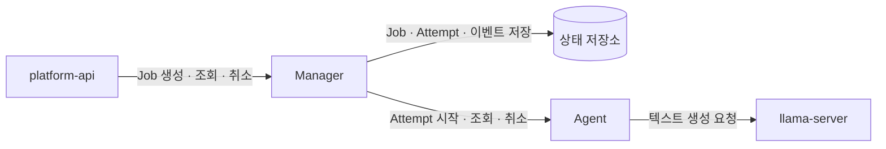

# Orchestrator

Orchestrator는 오래 걸리는 작업을 접수하고, 워커가 수행한 각 실행의 결과를 기록하는 Go 기반 작업 관리 시스템이다. 첫 적용 대상은 텍스트 생성이다. 호출자는 추론이 끝날 때까지 HTTP 연결을 유지할 필요 없이 Job ID로 진행 상황과 결과를 조회한다.

이 문서는 목표 설계를 설명한다. 현재 저장소에는 Go 모듈이 정의되어 있으며, 첫 구현 범위는 Manager 한 대와 단일 슬롯 Agent 한 대에서 `ai.text.generate` 작업을 끝까지 처리하는 것이다.

주요 결정의 배경과 검증 기준은 [아키텍처 결정 기록(ADR)](docs/adr/README.md)에서 확인할 수 있다.

## 시스템 구성

| 구성 요소 | 책임 |
| --- | --- |
| Manager | Job API를 제공한다. 내부 Controller가 저장된 실행 의도를 읽어 Agent에 전달하고, 관찰한 결과로 Job의 상태와 재시도 여부를 결정한다. |
| 상태 저장소 | Job, 실행 이력, 상태 변경 이벤트, 멱등성 키를 보관한다. 초기 배포에서는 한 Manager가 로컬 파일 스냅샷을 소유한다. |
| Agent | 실행 슬롯과 추론 서버의 준비 상태를 제공한다. Attempt를 받아 추론을 수행하고 Manager의 조회에 진행률과 결과를 반환한다. |
| llama-server | 기존에 배포된 추론 서버다. 첫 Agent는 비스트리밍 `POST /v1/chat/completions`를 호출한다. |

이 저장소는 Manager, 작업 모델, 실행 규약과 공용 Go SDK를 담당한다. AI 실행기는 SDK와 HTTP·JSON 규약을 사용해 독립적으로 빌드한다. 모델별 요청 형식과 응답 해석은 실행기에 두고, 운영 설정에서는 호환되는 Manager·Agent 버전과 연결 정보를 관리한다.

## 작업 모델과 저장

**Job**은 사용자가 기다리는 작업 한 건이고, **Attempt**는 그 작업을 처리하기 위한 실행 한 번이다. 첫 추론이 시간 초과로 끝나고 두 번째가 성공하면 Job은 `SUCCEEDED`가 된다. 첫 Attempt의 `TIMED_OUT`과 두 번째 Attempt의 `SUCCEEDED`는 모두 이력에 남는다.

| 데이터 | 용도 |
| --- | --- |
| Job | 요청 모듈과 입력, 실행 백엔드, 제한 시간, 최대 시도 횟수, 현재 상태와 다음 재시도 시각을 보관한다. |
| Attempt | 고유 ID와 세대 번호(`generation`), 실행 참조, 시작·종료 시각, 결과 또는 실패 사유를 보관한다. 재시도할 때 새 ID를 발급하고 세대를 올린다. |
| Event | 어떤 Job과 Attempt에서 언제 상태가 바뀌었는지 기록한다. 실행 시작, 취소 요청, 종료를 순서대로 추적할 수 있다. |

Manager는 Job과 관련 Attempt·Event를 하나의 레코드로 갱신한다. 파일 저장소는 임시 파일에 스냅샷을 쓴 뒤 교체하고, 프로세스 잠금으로 같은 파일에 대한 동시 쓰기를 막는다. 새 Job의 저장이 성공해야 접수를 확정한다.

## 요청 한 건의 실행 흐름

1. **접수.** `platform-api`가 `POST /v1/jobs`로 요청을 보낸다. Manager는 모듈·입력·실행 정책을 검증한 뒤 Job과 첫 Attempt를 저장하고 Job ID를 반환한다.
2. **전달.** Controller는 실행을 시작하겠다는 의도를 먼저 저장한다. Agent가 준비되고 슬롯이 비면 같은 Attempt ID로 실행을 요청하고, 돌려받은 실행 참조를 저장한다.
3. **실행.** Agent가 `llama-server`에 추론을 요청한다. Manager는 Agent를 주기적으로 조회해 현재 Attempt의 진행 상태 또는 종료 결과를 받는다.
4. **확정.** Manager는 Attempt ID와 세대가 현재 실행과 일치하는지 확인한 뒤 결과와 이벤트를 저장한다. 호출자는 Job ID로 최종 상태와 각 시도의 이력을 조회한다.

### HTTP 인터페이스

| 호출 방향 | 주요 요청 |
| --- | --- |
| 호출자 → Manager | `POST /v1/jobs`로 접수하고 `GET /v1/jobs/{id}`로 결과를 조회한다. `GET /v1/jobs/{id}/attempts`와 `GET /v1/jobs/{id}/events`는 이력을 반환한다. |
| 호출자 → Manager | `POST /v1/jobs/{id}/cancel`은 취소 의도를 저장하고 `202 Accepted`를 반환한다. 호출자는 이후 Job 조회로 취소 완료를 확인한다. |
| Manager → Agent | `GET /v1/status`로 준비 상태를 확인하고 `POST /v1/attempts`로 시작한다. `GET /v1/attempts/{id}`로 실행을 관찰하고 `POST /v1/attempts/{id}/cancel`로 중단을 요청한다. |

Manager API와 Agent API는 각각 별도의 Bearer 토큰으로 인증한다. 두 서비스의 `GET /healthz`는 프로세스 생존을 확인한다. 호출자는 Manager의 `GET /v1/workers`에서 Agent 연결, 추론 준비 상태, 슬롯 가용 여부를 확인할 수 있다.

## 실패 처리와 복구

| 상황 | 처리 규칙 |
| --- | --- |
| 접수 응답이 유실됨 | 같은 `Idempotency-Key`와 같은 요청을 다시 보내면 기존 Job을 반환한다. 같은 키에 다른 요청을 보내면 `409 Conflict`를 반환한다. |
| 실행 슬롯이 사용 중이거나 시작 응답이 유실됨 | 슬롯 대기 중에는 같은 Attempt를 유지한다. 시작 요청을 다시 보낼 때도 같은 Attempt ID를 사용해 Agent가 중복 실행을 막는다. |
| 추론 실패 또는 시간 초과 | 해당 Attempt의 종료 사유를 기록한다. 남은 시도가 있으면 Job을 `RETRY_WAIT`로 두고 재시도 시각에 새 Attempt를 만든다. 시도를 소진하면 실패 또는 시간 초과로 확정한다. |
| 취소 요청과 실행 완료가 겹침 | 취소 의도를 먼저 저장했다면 Job은 `CANCELLED`로 확정하고, Attempt에는 실제 관찰한 종료 상태를 남긴다. 이미 종료된 Job에는 새 취소를 적용하지 않는다. |
| Manager 또는 Agent가 재시작됨 | Manager는 저장된 미완료 Attempt를 Agent의 실행 기록과 대조한다. Agent 인스턴스가 바뀌었거나 기존 실행 기록이 유실되면 Attempt를 `LOST`로 기록하고 재시도 정책을 적용한다. |

운영 시에는 `job_id`로 접수부터 최종 조회까지 추적하고, `attempt_id`와 `generation`으로 어느 시도에서 문제가 생겼는지 좁힌다. 이전 세대에서 늦게 도착한 결과는 현재 Job 상태에 반영하지 않는다.

## 개발 순서와 확장 범위

1. **작업 모델과 실행 규약** — Job·Attempt·Event와 상태 전이 규칙을 정하고, 실행기의 시작·조회·취소·복구 계약을 정의한다.
2. **접수와 저장** — 생성·조회 API와 파일 저장소를 연결한다. 중복 접수와 저장 실패 시 응답을 검증한다.
3. **원격 실행** — Manager와 단일 슬롯 Agent를 연결하고 텍스트 생성 한 건이 접수부터 결과 조회까지 이어지는지 검증한다.
4. **복구와 배포** — 취소 경합, 시간 초과, 재시도, 프로세스 재시작을 검증한다. Manager와 Agent를 독립적으로 빌드하고 호환 버전을 고정해 배포한다.

완료 작업·이벤트와 Agent 실행 기록의 보존 기간은 후속 설계 과제다. 실행량이 늘어날 때는 다중 Agent 스케줄링, MariaDB 기반 상태 저장, Redis Streams를 통한 작업 전달을 검토한다. Kubernetes Job과 Python Task Runtime은 같은 실행 규약으로 연결할 수 있는 확장 후보다.
